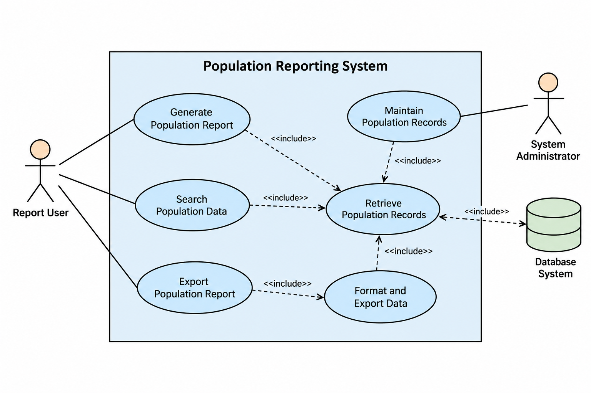

SET09803 DevOps Group Coursework
Population Reporting System
Formal Use Case Specifications
and
UML Use Case Documentation
Module: SET09803 DevOps
Project: Population Reporting System
Document Type: System Requirements Documentation
Prepared By: Ali Octave
Role: Systems Analyst and Documentation Lead
Version: Version 1.0
Date: September 2026
GitHub Documentation Artifact:
/docs/use-cases.md

Contents
1 Introduction 2
1.1 Document Purpose . . . . . . . . . . . . . . . . . . . . . . . . . . . . . . 2
1.2 System Overview . . . . . . . . . . . . . . . . . . . . . . . . . . . . . . . 2
2 System Actors 3
3 Formal Use Case Specifications 4
3.1 Use Case UC-001: Generate Population Report . . . . . . . . . . . . . . 4
3.2 Use Case UC-002: Search Population Data . . . . . . . . . . . . . . . . . 5
3.3 Use Case UC-003: Maintain Population Records . . . . . . . . . . . . . . 6
3.4 Use Case UC-004: Export Population Report . . . . . . . . . . . . . . . 6
4 UML Use Case Diagram 8
5 Conclusion 10

1 Introduction
1.1 Document Purpose
This document presents the formal use case specifications for the Population Reporting
System. The purpose of this document is to define the functional requirements of the
system by describing interactions between system users and system components.
The use cases provide a structured description of how users interact with the system to
search population information, generate reports, export results, and maintain population
records.
This documentation supports the software development process by providing a clear
understanding of expected system behavior before implementation.
1.2 System Overview
The Population Reporting System is a database-driven application designed to store,
retrieve, process, and report population information. The system allows authorized users
to access population records and generate reports based on specified requirements.
The system consists of:
• User interface for interaction.
• Application logic for processing requests.
• Database layer for storing population information.
• Reporting functionality for generating outputs.

2 System Actors
Actor Description
Report User A user who accesses the system to search population
information and generate reports based on
selected criteria.
System Administrator A privileged user responsible for maintaining population
records, system configuration, and ensuring
data integrity.
Database System The database component responsible for storing
and retrieving population records required by system
operations.

3 Formal Use Case Specifications
3.1 Use Case UC-001: Generate Population Report
Attribute Description
Use Case ID UC-001
Use Case Name Generate Population Report
Primary Actor Report User
Goal To allow users to generate population reports
based on selected parameters.
Description The user provides reporting criteria and the system
retrieves relevant population information from
the database and presents the results.
Preconditions
• User has access to the system.
• Database connection is available.
• Population records exist.
Postconditions A population report is successfully generated and
displayed.
Trigger The user selects the report generation option.

Main Success Scenario
1. User logs into the system.
2. User selects “Generate Population Report”.
3. User enters required search parameters.
4. System validates user input.
5. System sends query request to database.
6. Database returns matching population records.
7. System processes retrieved information.
8. System displays the generated report.
   
   Alternative Flow
   Invalid Input
1. User enters incomplete or invalid information.
2. System validates the information.
3. System displays an error message.
4. User updates the input and retries.
   
   Exceptions
   • Database unavailable.
   • No matching population records found.
   • System processing failure.
   
   3.2 Use Case UC-002: Search Population Data
   
   Attribute Description
   Use Case ID UC-002
   Use Case Name Search Population Records
   Primary Actor Report User
   Goal Allow users to search population information using
   defined filters.
   Preconditions Database connection must be active.
   Postconditions Matching population records are displayed.
   
   Main Success Scenario
1. User enters search criteria.
2. System receives search request.
3. System validates search parameters.
4. System queries the database.
5. System displays matching records.
   
   3.3 Use Case UC-003: Maintain Population Records
   Attribute Description
   Use Case ID UC-003
   Use Case Name Maintain Population Database
   Primary Actor System Administrator
   Goal Allow administrators to add, update, and delete
   population records.
   Preconditions Administrator authentication completed.
   Postconditions Population records are updated successfully.
   
   Main Success Scenario
1. Administrator logs into the system.
2. Administrator accesses record management functions.
3. Administrator creates, updates, or removes records.
4. System validates changes.
5. System stores updated information.
   
   3.4 Use Case UC-004: Export Population Report
   Attribute Description
   Use Case ID UC-004
   Use Case Name Export Report
   Primary Actor Report User
   Goal Allow users to save generated reports in external
   formats.
   Preconditions A report must already exist.   
   Postconditions Export file is generated successfully.
  
   Main Success Scenario
1. User selects export option.
2. User chooses preferred format.
3. System converts report data.
4. System creates export file.
5. User downloads the report.

4 UML Use Case Diagram
The following UML diagram illustrates the relationship between system actors and major
system functions.
+------------------------------+
| Population Reporting System |
| |
User ---------->| Generate Report |
| |
User ---------->| Search Population Data |
| |
User ---------->| Export Report |
| |
Admin --------->| Maintain Records |
| |
| Retrieve Database Records |
+------------------------------+
Database System interacts with data retrieval functions.
Figure 4.1: Population Reporting System Use Case Overview

Figure 4.2: Population Reporting System Use Case Diagram

5 Conclusion
This document provides the formal functional description of the Population Reporting
System. The use cases define the expected behavior of the system and provide a foundation
for software development, testing, and continuous integration activities.
The specifications will guide implementation, testing activities, and future documentation
updates within the DevOps workflow.